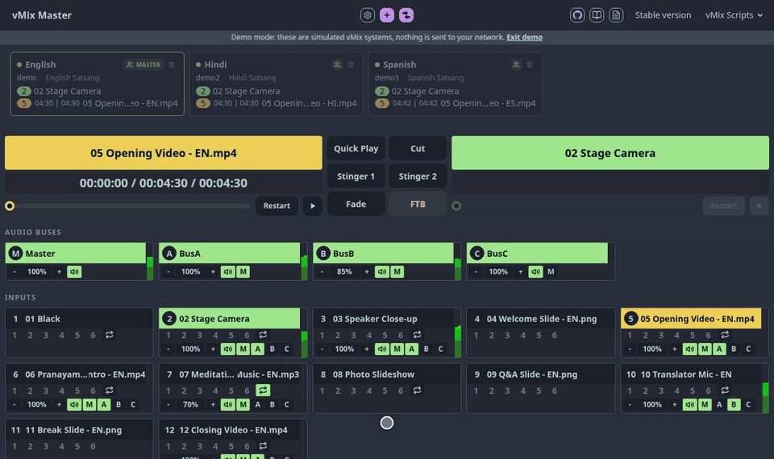
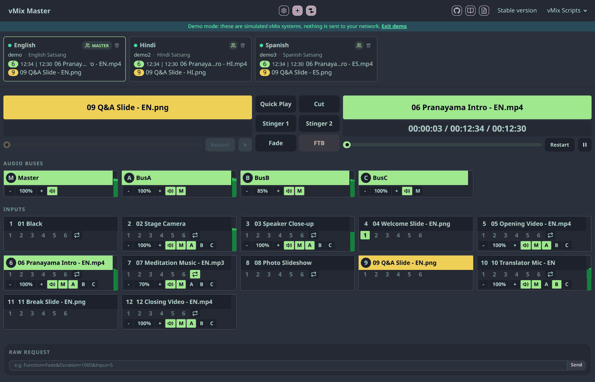

# vMix Master

[](https://github.com/live-miracles/vmix-master/actions/workflows/ci.yml) [](LICENSE) [](https://live-miracles.github.io/vmix-master/?demo)

**A complete control panel for vMix in your browser: one system, or several working as one. Nothing to install.**

### [▶ Try the live demo](https://live-miracles.github.io/vmix-master/?demo) &nbsp;·&nbsp; [Open the app](https://live-miracles.github.io/vmix-master/) &nbsp;·&nbsp; [Documentation](docs/README.md)

The demo runs three simulated vMix systems in your browser, so you can try everything without vMix and nothing is sent over the network.

<p align="center">
  
</p>

vMix Master puts the whole show on one page: every input by name, program and preview with timers, overlays, audio buses with meters, playback controls, and any vMix function. It works just as well for a single vMix. When a production uses more than one machine, such as a main stream plus translated streams, a hot backup, or several rooms that must switch together, pick one vMix as the master and add the others to its group. Every switch, audio change, or custom API command is then sent to all of them.

## Features

- **Group control:** commands from the panel go to the master and every vMix in its group. The master is marked on its group button.
- **Program and preview:** large timers, a position slider, **Restart** and **Play/Pause**, and six transition buttons (Quick Play, Cut, Stinger 1, Stinger 2, Fade, FTB).
- **Names, not codes:** every input is shown by its name, so you can tell what is what at a glance.
- **Inputs and audio:** every input as a tile with overlays 1–6, loop, volume, and send-to-bus buttons, plus the audio buses with live level meters.
- **At-a-glance status:** each vMix has a status dot (connected, unreachable, no address), and its program and preview inputs.
- **Edit in place:** double-click a name or an address to change it, and toggle group membership with one click.
- **Function buttons:** start and stop outputs (external, SRT), audio, playback, timers, and scripts, grouped by category, plus a raw request box for any vMix API function.
- **Setup check:** compare group members for mismatched buses, call sources, input types, layers, and durations before you go live.
- **Follow-the-master scripts:** drop-in vMix scripts make the other systems copy the master's active input, preview, and playback position, see [vMix scripts](#vmix-scripts).
- **Works on a phone or tablet** and can be installed as an app from Chrome.
- **Zero install:** it is a static page. Open the hosted site, or run it from a local copy.

<p align="center">
  
</p>

## How it compares

Each tool fits a different job.

|                           | **vMix Master**                                         | vMix Web Controller (built-in)                    | Bitfocus Companion                                     |
| ------------------------- | ------------------------------------------------------- | ------------------------------------------------- | ------------------------------------------------------ |
| Best for                  | Full control of one vMix, or several switching together | A few inputs and simple switching and transitions | Custom button surfaces and hardware (e.g. Stream Deck) |
| Install                   | None, runs in the browser                               | None, built into vMix                             | A separate app running on a machine                    |
| Multiple vMix instances   | ✅ Yes, via master/group                                | ❌ One instance per page                          | ⚠️ Yes, but you build the pages and sync logic         |
| Input labels              | ✅ Names, e.g. `05 Opening Video.mp4`                   | ❌ Type letter and number only, e.g. `V 5`        | ⚠️ Whatever you label each button as                   |
| Follow-the-master scripts | ✅ Included                                             | ❌                                                | ❌                                                     |
| Setup comparison          | ✅                                                      | ❌                                                | ❌                                                     |
| Hardware control surfaces | ❌                                                      | ❌                                                | ✅                                                     |
| Free and open source      | ✅                                                      | ❌ Part of vMix (not open source)                 | ✅                                                     |

✅ yes &nbsp; ❌ no &nbsp; ⚠️ possible with extra work

**Easy to read at a glance.** In a live show you shouldn't have to remember that `V 5` is the opening video. vMix Master shows every input by its name and number, with its audio level, marks what is on air and in preview, and shows a large timer for both. The built-in Web Controller labels inputs only with a type letter and a number (for example `C 2` or `V 5`), as described in [vMix's own guide](https://www.vmix.com/knowledgebase/article.aspx/69/how-to-control-vmix-from-a-web-browser-using-vmix-web-controller).

Use the built-in Web Controller if you have a few inputs and only need simple switching and transitions, and Companion if you want physical buttons. Use vMix Master when you want fuller control from a browser, and whenever several vMix machines need to switch together.

## Quick start

0. Want to look around first? Open the [demo](https://live-miracles.github.io/vmix-master/?demo).
1. Enable the Web Controller in vMix (**Settings → vMix Web Controller** tab). The default port is `8088`.
2. Open [the hosted app](https://live-miracles.github.io/vmix-master/) in Chrome, allow the local network access prompt, and add your vMix machines by IP.
3. Mark the master, tick **Part of Group** on the others, and start switching.
4. For automatic follow-the-master, load `slave.vb` or `name-slave.vb` into each slave vMix and set the master IP.

> Note: Chrome can connect from the hosted HTTPS GitHub Pages site to vMix over HTTP on your local network. The first time, Chrome asks whether to allow the site to access devices on your local network. Choose **Allow**. The page only talks to the vMix addresses you enter. For fully offline use, clone the `gh-pages` branch or download the ZIP from the `gh-pages` branch, then open `index.html` from the cloned or extracted folder in Chrome.

## vMix scripts

Ready-to-use scripts for vMix's scripting feature (4K and Pro editions) are in [`vmix-scripts/`](vmix-scripts/). The [scripts guide](docs/2-scripts/1-overview.md) explains how to add them to vMix, and each script has its own page with its settings. The app shows their current versions under **vMix Scripts**.

| Script                                              | What it does                                                                                                           |
| --------------------------------------------------- | ---------------------------------------------------------------------------------------------------------------------- |
| [Slave](docs/2-scripts/2-slave.md)                  | Follows a master vMix: active input, preview, and playback position.                                                   |
| [NameSlave](docs/2-scripts/3-name-slave.md)         | Follows a master by input name instead of number, with a fallback input when there is no match.                        |
| [PreviewNext](docs/2-scripts/4-preview-next.md)     | Puts the next input into preview after each transition.                                                                |
| [Translator](docs/2-scripts/5-translator.md)        | Sidechain ducking: lowers the program audio while the translator speaks, then raises it again smoothly.                |
| [AutoGain](docs/2-scripts/6-auto-gain.md)           | Adjusts the gain of audio and call inputs (and inputs named "AutoGain") to keep the top peaks in range.                |
| [AudioFade](docs/2-scripts/7-audio-fade.md)         | Fades audio in and out during transitions for inputs with "AudioFade" in their title.                                  |
| [DurationTimer](docs/2-scripts/8-duration-timer.md) | Writes the remaining time of the current input into a title named "DurationTimer" (counts up if there is no duration). |

## Development

```sh
npm install
npm run dev
```

Common npm commands:

```sh
npm run build
npm test
npm run format
npm run format:check
```

The project uses npm scripts only. The website root lives in `public/`, and the TypeScript source lives in `public/ts/`. `npm run dev` serves the site at `http://localhost:3000` with live reload for TypeScript, HTML, CSS, and static asset changes. `npm run build` compiles browser scripts into ignored `public/js/` and DaisyUI/Tailwind CSS into ignored `public/output.css`.

The demo is a small simulated vMix in [`public/ts/demo.ts`](public/ts/demo.ts). Boxes whose host is `demo`, `demo2`, and so on are answered by it instead of the network, and `?demo` opens three grouped ones.

Every push to `master` runs GitHub Actions, executes the unit tests, builds the ignored assets, and publishes the current site to the `gh-pages` branch.

## Feedback

Found a bug or have an idea? Please [open an issue](https://github.com/live-miracles/vmix-master/issues). vMix Master is released under the [MIT License](LICENSE).
